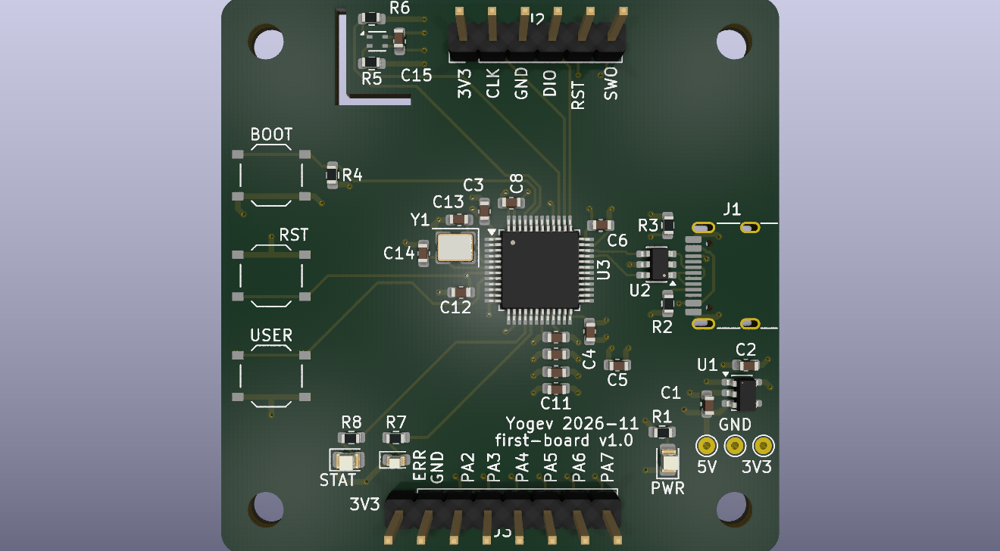

# first-board: STM32G431 sensor development board

A 50 × 50 mm, 4-layer development board built around an STM32G431, with a temperature/humidity sensor, USB-C and SWD.
My first PCB: designed in KiCad 10, manufactured and assembled by JLCPCB.

Designed by Yogev Raz.

## Features

- **MCU:** STM32G431CBT6 (Arm Cortex-M4F, 170 MHz, 128 KB flash, 32 KB SRAM), LQFP-48, 12 MHz crystal
- **USB-C:** USB 2.0 full-speed device, USBLC6-2SC6 ESD protection on D+/D−, 5.1 kΩ CC pull-downs
- **Power:** 5 V from USB-C, AP2112K-3.3 LDO (600 mA)
- **Sensor:** Sensirion SHT40 (temperature and humidity, I²C address 0x44), thermally isolated from the rest of the board by an L-shaped slot
- **User I/O:** BOOT, RESET and USER buttons; PWR, STAT and ERR LEDs
- **Headers:** 6-pin SWD (3V3, CLK, GND, DIO, RST, SWO) and 8-pin expansion (3V3, GND, PA2–PA7)
- **Test points:** 5V, GND, 3V3
- **PCB:** 4 layers (signal / GND / 3V3 / signal), 4 × M3 mounting holes

## Documents

- [Schematic (PDF)](docs/first-board.pdf)
- [Design specification (PDF, Hebrew)](docs/board-spec.pdf)

## Repository layout

| Path | Contents |
|---|---|
| `first-board.kicad_pro`, `.kicad_sch`, `.kicad_pcb` | KiCad 10 project |
| `first-board.pretty/` | Project footprint library (USB-C receptacle) |
| `first-board.ioc` | STM32CubeMX pin planning |
| `jlcpcb/` | Manufacturing files as sent to JLCPCB: Gerbers and drill files, BOM, CPL |
| `docs/` | Schematic PDF, design specification, renders |

## Manufacturing (v1.0)

- Ordered from JLCPCB in November 2026: 5 PCBs, 2 of them assembled (Economic PCBA)
- 35 SMD parts (16 part types) placed by JLCPCB; the SWD and expansion headers (J2, J3) are hand-soldered
- Rotation offsets between the KiCad footprints and the JLCPCB part library were corrected in the CPL file (U1, U2, U3)
- DRC and ERC clean at release

## Status

- [x] Schematic and layout
- [x] Ordered (v1.0)
- [ ] Bring-up
- [ ] Firmware

## Planned for v1.1

- TVS diode on VBUS and ESD protection on the CC lines
- RC network between the USB shield and GND
- Qwiic (I²C) connector
- Jumper for measuring board current
- Prefer JLCPCB Basic parts, and a stackup that Economic PCBA supports
